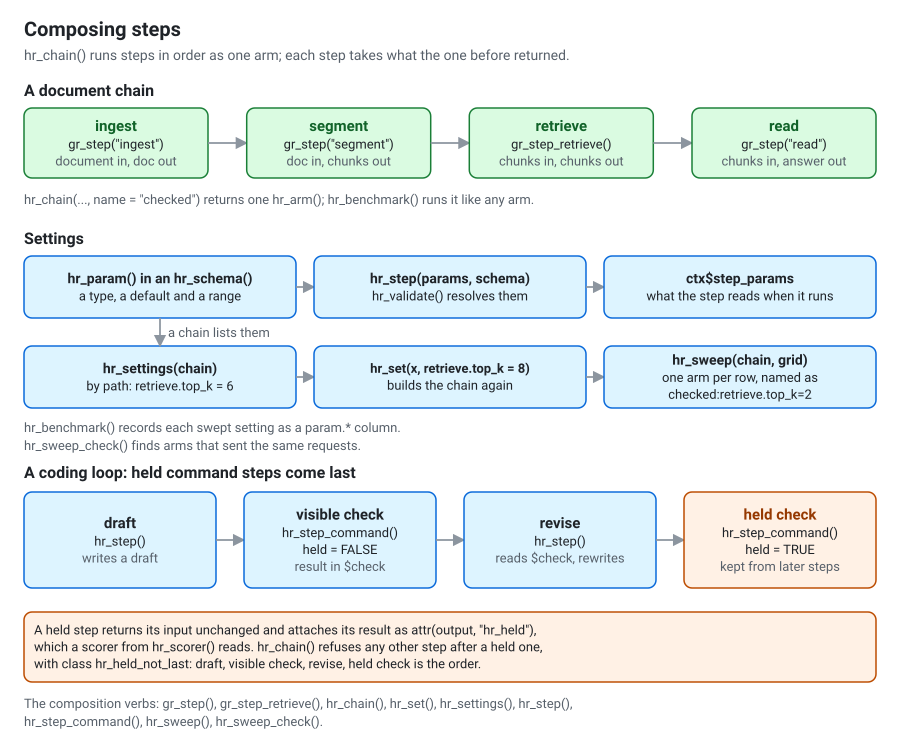

```{r setup, include = FALSE}
knitr::opts_chunk$set(collapse = TRUE, comment = "#>")
```

A recipe such as `needle` runs a fixed sequence of stages: segment the
document, rank the chunks, read the best. For a sequence of your own, such as
one with a check after the answer or a step that rewrites the question, you
build it from steps and run them in order as one arm. That arm is an ordinary
`hr_arm()`, so `hr_benchmark()` compares it with recipes and with other chains
on the same labelled questions, as `vignette("compare")` does for recipes.

`hr_chain()` passes each step's output to the next step. A step's settings
come from its schema and reach it as `ctx$step_params`. No step that is not
held may follow a held command step:

```{r composition, echo = FALSE, out.width = "100%", fig.alt = "hr_chain() runs ingest (document in, doc out), segment (doc in, chunks out), retrieve (chunks in, chunks out) and read (chunks in, answer out), each step handing its output to the next. Settings declared with hr_param() and hr_schema() pass through hr_step() and hr_validate() to ctx$step_params; hr_settings() lists them by path, hr_set() changes them and hr_sweep() makes one arm per row. A coding loop runs draft, visible check, revise and held check, and the held command step comes last."}

```

Everything here runs offline on a stand-in model.

```{r message = FALSE}
library(harnessr)
old <- hr_options(verbose = FALSE, embedder = "lexical")
cl <- hr_mock_client(function(messages, params) {
  if (grepl("You grade one response", messages[[1]]$content, fixed = TRUE)) {
    return('{"verdict": "pass", "reason": "It gives the figure."}')
  }
  "Revenue was 45.2 million dollars."
})
ref <- gr_qa_reference(
  questions = c(revenue = "What was revenue in 2024?"),
  documents = gr_example(), answers = list("45.2 million"), split = "test")
```

## Steps

A step is a function of `(input, ctx)` that does one part of a run.
`gr_step()` builds a step for a document stage: `"ingest"`, `"segment"` or
`"read"`. `gr_step_retrieve()` builds a step that ranks the chunks and keeps
the best without asking for an answer. Both take the settings the stage's spec
takes, and both check them when they build the step:

```{r}
gr_step_retrieve(top_k = 4)
try(gr_step("read", reader = "no_such_reader"))
```

`hr_step()` builds a step of your own. Inside a chain, `ctx` is the context
that `hr_benchmark()` gives an arm: its client, its trace, the `judge` and
`note` shortcuts, and `params`. `ctx$step` holds the step's name and
`ctx$step_params` its settings. The step below grades the answer with a model
and records the verdict as a signal of the run:

```{r}
judge <- hr_step("judge", function(a, ctx) {
  j <- ctx$judge(a$answer, mode = "grade", reference = "45.2 million",
                 rubric = "Does it give the figure?", orders = 1)
  ctx$note("judged", j$verdicts$verdict[1])
  a
}, input = "answer", output = "answer")
```

The optional `input` and `output` arguments declare what a step takes and
returns: `"document"`, `"doc"`, `"chunks"`, `"answer"` or `"state"`.
`hr_chain()` uses them to check the order of the steps.

## Chains

`hr_chain()` runs its steps in order. The first step gets the item, each later
step gets what the step before it returned, and the chain returns what the
last step returns. The name you give each argument is that step's name in the
chain.

```{r}
checked <- hr_chain(segment = gr_step("segment"),
                    retrieve = gr_step_retrieve(top_k = 4),
                    read = gr_step("read", reader = "stuff"),
                    judge = judge, name = "checked")
checked
```

The arm records each step's settings as `"step.setting"`, so a benchmark of
`checked` has a `param.retrieve.top_k` column. To derive one chain from
another, pass the old chain and name the steps to change:

- `NULL` drops a step.
- A step under an existing name replaces that step where it stands.
- A step under a new name goes at the end.

```{r}
nojudge <- hr_chain(checked, judge = NULL, name = "nojudge")
wider <- hr_chain(checked, retrieve = gr_step_retrieve(top_k = 8), name = "wider")
names(attr(wider, "hr_steps"))
```

The three chains run side by side like any other arms. Each run sends its
requests at its own draw, so a cache does not hand one run's reply to the next:

```{r}
bench <- hr_benchmark(list(checked, nojudge, wider), ref, runs = 5, client = cl,
                      scorer = gr_scorer_answer())
aggregate(correct ~ arm + param.retrieve.top_k, bench, mean)
head(hr_signals(bench, "judged")[, c("arm", "run", "item", "value")], 3)
```

### What a chain checks when it is built

`hr_chain()` warns with class `hr_chain_gap` when a step takes chunks and no
step before it returns them. Without the warning, a read step would cut the
document at the default settings without saying so. A segment step first in a
chain does not warn, though it reads the document at the default ingest
settings; put an ingest step before it to choose them.

After a step that returns the answer, only steps that take `"answer"` or
`"state"`, or declare nothing, can follow.

```{r}
tryCatch(hr_chain(read = gr_step("read", reader = "stuff"), name = "gap"),
         hr_chain_gap = function(w) conditionMessage(w))
try(hr_chain(segment = gr_step("segment"), read = gr_step("read", reader = "stuff"),
             retrieve = gr_step_retrieve(), name = "late"))
```

Step names cannot repeat, and they cannot contain a dot, because settings are
named `"step.setting"`.

### When two chains are the same

A chain's configuration is a hash of its steps' code, the values that code
reads, and their resolved settings. Two chains with the same configuration
send the same requests, and `hr_benchmark()` warns with class
`hr_same_config` when you ask it to compare them. A setting given at its
default gives the same configuration as the setting left out:

```{r}
a <- hr_chain(segment = gr_step("segment"), retrieve = gr_step_retrieve(), name = "a")
b <- hr_chain(segment = gr_step("segment"), retrieve = gr_step_retrieve(top_k = 6),
              name = "b")
identical(attr(a, "hr_config"), attr(b, "hr_config"))
```

## Settings and sweeps

Every step built with a schema has settings:

- a `gr_step()` step has the settings the stage's spec takes;
- a `gr_step_retrieve()` step has the ranking settings;
- a step of your own has the settings its `schema` declares.

In a chain, each setting is named by its path, `"step.setting"`.
`hr_settings()` lists them all. For each one it gives the value the step
resolved, whether you gave it, and the default, range and evidence the schema
declares:

```{r}
s <- hr_settings(checked)
nrow(s)
s[s$set, c("step", "param", "value", "default", "range")]
s[s$step == "retrieve", c("param", "value", "range", "status")]
```

`hr_set()` builds the chain again with some settings changed and the rest as
they were. It builds each changed step again from its settings, so the new
values go through the same checks as when the step was first built. The new
chain has the configuration of its new settings:

```{r}
wide <- hr_set(checked, retrieve.top_k = 8, read.max_answer_tokens = 400)
wide$params
identical(attr(wide, "hr_config"), attr(checked, "hr_config"))
```

A number outside its range moves to the nearest bound with a warning of class
`hr_param_clamped`. A path that is not a setting of a step's schema is an
error of class `hr_unknown_setting`, and its message lists the step's
settings.

`hr_set()` cannot change a setting that a step keeps fixed either.
`gr_step_retrieve()`, for example, keeps a `max_answer_tokens` you give it
fixed: it passes the value to the read spec and does not rank by it. To change
a fixed setting, build the step again and replace it with `hr_chain()`.

```{r}
tryCatch(hr_set(checked, retrieve.top_k = 50000),
         hr_param_clamped = function(w) conditionMessage(w))
try(hr_set(checked, retrieve.topk = 8))
```

For a single step, the setting's own name is enough:
`hr_set(gr_step_retrieve(), top_k = 2)`.

`hr_sweep()` takes a chain and a grid whose columns are paths, and builds one
chain per row with `hr_set()`. Each arm records its settings, so you can group
the benchmark by its `param.retrieve.top_k` column. When a row builds the
configuration of an earlier row, `hr_sweep()` drops it with a message of class
`hr_sweep_collapsed`.

```{r}
arms <- hr_sweep(nojudge, data.frame(retrieve.top_k = c(2, 4, 8)))
names(arms)
bench <- hr_benchmark(arms, ref, runs = 5, client = cl, scorer = gr_scorer_answer())
aggregate(correct ~ param.retrieve.top_k, bench, mean)
```

Changing a setting the chain's steps never use changes nothing that is sent,
so a sweep over it compares the chain with itself. `hr_sweep_check()` finds
such settings from the requests each arm sent. Here the read step sends every
chunk it gets, so its own `top_k` does nothing:

```{r}
stuffed <- hr_chain(segment = gr_step("segment"), read = gr_step("read", reader = "stuff"),
                    name = "stuffed")
bench <- hr_benchmark(hr_sweep(stuffed, list(read.top_k = c(2, 8))), ref, runs = 5,
                      client = cl, scorer = gr_scorer_answer())
hr_sweep_check(bench)
```

A swept chain is a chain like any other: you can derive a chain from it with
`hr_chain()` and change it further with `hr_set()`.

A replay of a recorded benchmark matches each run's sampled requests by the
arm's name. A renamed or swept chain therefore does not replay a recording
made under another name; record the benchmark again under the new names.

## Skills

A skill is a folder of instructions for one step. It holds:

- a `SKILL.md` file with a short header and the instructions;
- optional text files under `references/`;
- optional scripts under `scripts/`.

`hr_skill()` reads a folder you choose. harnessr never looks for skills on its
own, and a model never chooses one: you pick the skill and the step it goes
to.

The header sits between two `---` lines. `hr_skill()` reads it without a YAML
parser, so each line is a plain `key: value`. `name` is required, and
`hr_skill()` keeps `description` and `version`. Any other key warns with class
`hr_skill_unknown_key`, and a nested or multi-line value is an error of class
`hr_bad_skill`. The example writes this skill into a temporary folder:

```{r}
skill_dir <- file.path(tempdir(), "units-skill")
dir.create(file.path(skill_dir, "references"), recursive = TRUE, showWarnings = FALSE)
writeLines(c("---",
             "name: units",
             "description: State every amount with its unit and currency.",
             "version: 1.0.0",
             "---",
             "Give every amount with its unit and its currency, as in",
             "'45.2 million dollars', never a bare number."),
           file.path(skill_dir, "SKILL.md"))
writeLines("Write 'million' in full; do not write 'M' or 'mn'.",
           file.path(skill_dir, "references", "style.md"))
units <- hr_skill(skill_dir)
units
```

harnessr puts the skill's text into the prompt as it is written. A skill from
someone else can carry instructions you did not mean to send (prompt
injection), so read a skill before you use it. harnessr lists the scripts and
never runs them. To run one, wrap it in a command step yourself, as in
`hr_step_command("lint", c(rscript, units$scripts[["check.R"]]))`.

Give a skill to a step of your own with `hr_step(skill = )`. Inside a chain,
the step's `ctx$call()` and `ctx$call_json()` then send the instructions and
the references as a system message before the step's own messages, and
`ctx$skill` holds the skill. The built-in steps of `gr_step()` and
`gr_step_retrieve()` refuse a skill, because they build their requests in the
stage they run. The stand-in model below answers with the unit only when the
skill's instructions reach it:

```{r}
units_cl <- hr_mock_client(function(messages, params) {
  skilled <- messages[[1]]$role == "system" &&
    grepl("unit and its currency", messages[[1]]$content, fixed = TRUE)
  if (skilled) "Revenue was 45.2 million dollars." else "Revenue was 45.2."
})
answer <- function(skill = NULL) {
  hr_step("answer", function(item, ctx) ctx$call(item$question)$text,
          input = "state", output = "answer", skill = skill)
}
baseline <- hr_chain(answer = answer(), name = "no-skill")
skilled <- hr_chain(answer = answer(units), name = "units-skill")
skilled$params
identical(attr(baseline, "hr_config"), attr(skilled, "hr_config"))
```

The skill's hash covers its header, instructions, references and every byte
of its scripts. The hash is part of the step's fingerprint, so the two chains
have different configurations. The chain records the skill as the setting
`answer.skill`, and a benchmark shows it as `param.answer.skill`. When the
skill has a version, the step takes that version.

To test whether a skill does what it says, compare the chain with and without
it on the same questions, using a scorer that checks the skill's rule. The
scorer here checks that the answer names the currency:

```{r}
questions <- c(q1 = "What was revenue in 2024?", q2 = "What was revenue in 2023?",
               q3 = "What was the operating cost?", q4 = "What was the order backlog?",
               q5 = "What was spent on research?", q6 = "What was the net income?")
units_ref <- hr_reference(lapply(as.list(questions), function(q) list(question = q)),
                          labels = rep("dollars", length(questions)),
                          cluster = names(questions), split = "test")
has_unit <- hr_scorer(function(item, output, label) {
  ok <- grepl(label, output, fixed = TRUE)
  list(correct = ok, outcome = if (ok) "unit" else "bare", failure_kind = NA)
}, name = "has_unit")
units_bench <- hr_benchmark(list(baseline, skilled), units_ref, runs = 5,
                            client = units_cl, scorer = has_unit)
units_report <- hr_report(units_bench, B = 200)
units_report$accuracy[, c("arm", "estimate", "lower", "upper")]
units_report$contrasts[, c("arm1", "arm2", "estimate", "lower", "upper")]
```

A skill is not a setting of a step's schema, so neither `hr_set()` nor a
sweep by path can swap it. To sweep a skill, give `hr_sweep()` a function that
builds the chain from a grid column:

```{r}
arms <- hr_sweep(function(use_skill) {
  hr_chain(answer = answer(if (use_skill) units), name = "answer")
}, data.frame(use_skill = c(FALSE, TRUE)))
names(arms)
```

```{r include = FALSE}
unlink(skill_dir, recursive = TRUE)
```

## A coding sub-agent

Steps do not have to read documents. A coding sub-agent drafts code with a model,
runs the tests on the draft, and asks the model to fix a draft that failed.
`hr_step_command()` (see `vignette("evaluate")`) runs the tests: it runs one
program you name and reads its result as `"passed"` or `"failed"`.

The loop has two checks:

- A visible check runs after the draft. The revise step reads its result in
  `input$check`.
- A held check runs last. Only the scorer sees it, in
  `attr(output, "hr_held")`.

A revise step that saw the scoring check could fit the code to that check, so
a held step must come last. `hr_chain()` refuses a step that is not held after
one that is, with an error of class `hr_held_not_last`. Here the visible and
the held check run the same tests; a held check can also run tests the loop
never sees.

The example puts the tests and the drafts in a temporary folder. The stand-in
model drafts a `clamp()` with a bug, and sends the fixed version when told the draft failed:

```{r}
rscript <- file.path(R.home("bin"), "Rscript")
work <- file.path(tempdir(), "coding-loop")
dir.create(work, showWarnings = FALSE)
tests <- file.path(work, "test-clamp.R")
writeLines(c("stopifnot(clamp(5, 0, 3) == 3)", "stopifnot(clamp(2, 0, 3) == 2)"), tests)
coder <- hr_mock_client(function(messages, params) {
  text <- messages[[length(messages)]]$content
  if (grepl("failed its tests", text, fixed = TRUE)) {
    "clamp <- function(x, lo, hi) max(lo, min(x, hi))"
  } else {
    "clamp <- function(x, lo, hi) max(lo, max(x, hi))"
  }
})
```

The draft step writes the reply to a file, the command runs the tests on
that file, and the revise step sends the code and what the tests printed:

```{r}
draft <- hr_step("draft", function(item, ctx) {
  code <- tempfile("clamp-", tmpdir = work, fileext = ".R")
  writeLines(ctx$call(item$task)$text, code)
  list(code = code)
})
run_tests <- function(input, ctx) {
  c(rscript, "-e", sprintf("source('%s'); source('%s')",
                           gsub("\\\\", "/", input$code), gsub("\\\\", "/", tests)))
}
revise <- hr_step("revise", function(input, ctx) {
  if (identical(input$check$status, "passed")) return(input)
  fixed <- ctx$call(paste0("This code failed its tests:\n",
                           paste(readLines(input$code), collapse = "\n"),
                           "\nWhat the tests printed:\n", input$check$stderr))$text
  writeLines(fixed, input$code)
  input
})
coding <- hr_chain(draft = draft,
                   check = hr_step_command("check", run_tests),
                   revise = revise,
                   held = hr_step_command("held", run_tests, held = TRUE),
                   name = "coding")
```

The scorer reads the held check. The second arm is the same chain without the
visible check and the revise step, so it scores the first draft. The loop
passes on every run:

```{r}
first <- hr_chain(coding, check = NULL, revise = NULL, name = "first-draft")
held_passes <- hr_scorer(function(item, output, label) {
  s <- attr(output, "hr_held")$held$status
  list(correct = identical(s, label), outcome = s, failure_kind = NA)
}, name = "held_passes")
tasks <- hr_reference(list(clamp = list(task = "Write clamp(x, lo, hi) in R.")),
                      labels = "passed", cluster = "clamp", split = "test")
cb <- hr_benchmark(list(coding, first), tasks, runs = 5, client = coder,
                   scorer = held_passes)
table(cb$arm, cb$outcome)
hr_signals(cb, "command.held")[1:2, c("arm", "run", "value")]
unlink(work, recursive = TRUE)
```

For a testthat file, give the check `parse = "testthat"`. It reads the last
`[ FAIL n | WARN n | SKIP n | PASS n ]` line the run printed, and a run with
a failed test is `"failed"` whatever its exit code. Run the file with a
reporter that prints that line, such as the default, `"progress"` or
`"check"`. A run that prints no such line, as under `"summary"`, reads as
`"error"`. Pass `stop_on_failure = TRUE` to `testthat::test_file()` as well if
you want the exit code to agree with the result.

A stand-in model's handler must be stateless: its reply should depend only
on the messages and settings it gets, as `coder`'s does. A handler that counts
its calls, or remembers the last request, answers by the order the requests
come in. That order changes when runs go to parallel workers, when a cache or
a recording answers some requests, and when you add arms. The same benchmark
would then score differently from one run to the next.

## Two goals, start to finish

### Run your own tests on the recipes

Here you sweep a recipe over a grid of its settings and run your own arm
beside it, on the same questions and under one spending limit. Given a
function, `hr_sweep()` builds one arm per row of the grid, and each arm records
its settings as `param.*` columns:

```{r}
my_arm <- hr_chain(segment = gr_step("segment"), retrieve = gr_step_retrieve(top_k = 4),
                   read = gr_step("read", reader = "stuff"), name = "mine")
arms <- hr_sweep(function(top_k, max_tokens) {
  gr_arm("needle", list(top_k = top_k, max_tokens = max_tokens))
}, expand.grid(top_k = c(2, 4, 8), max_tokens = c(200, 500)))
bench <- hr_benchmark(c(arms, list(my_arm)), ref, runs = 5, client = cl,
                      scorer = gr_scorer_answer(),
                      governor = hr_governor(max_cost_usd = 5))
aggregate(correct ~ param.top_k + param.max_tokens, bench, mean)
aggregate(correct ~ arm, bench, mean)
hr_sweep_check(bench)
```

The first table covers only the swept arms. Your arm has no `param.*`
settings, so `aggregate()` leaves its rows out. The second table has one row
per arm, yours included, so it compares the grid with your arm.

The example document is short. In chunks of 200 tokens, a `top_k` of 4 keeps
every chunk; in chunks of 500 tokens, a `top_k` of 2 does. `hr_sweep_check()`
finds the arms that sent the same requests as another arm, and those rows
compare a configuration with itself.

### Chain steps into a sub-agent of your own

Here you compare a chain that has a judge step with the same chain without
it, and sweep the chain over `top_k`. A cache answers any request sent twice.
The judge step grades the answer against a rubric with `ctx$judge()` and
records the verdict with `ctx$note()`:

```{r}
checked <- hr_chain(segment = gr_step("segment"), retrieve = gr_step_retrieve(top_k = 4),
                    read = gr_step("read", reader = "stuff"),
                    judge = hr_step("judge", function(a, ctx) {
                      j <- ctx$judge(a$answer, mode = "grade", reference = "45.2 million",
                                     rubric = "Does it give the figure?", orders = 1)
                      ctx$note("ok", j$verdicts$verdict[1])
                      a
                    }),
                    name = "checked")
bench <- hr_benchmark(c(list(checked, hr_chain(checked, judge = NULL, name = "nojudge")),
                        hr_sweep(checked, data.frame(retrieve.top_k = c(2, 8)))),
                      ref, runs = 5, client = hr_cache_client(cl, hr_cache(tempfile())),
                      scorer = gr_scorer_answer())
aggregate(correct ~ arm, bench, mean)
table(hr_signals(bench, "ok")$arm)
```

You build a coding sub-agent the same way, as in the section above: a draft
step, a visible check, a revise step, and the held check last.

```{r include = FALSE}
hr_options(old)
```

## Next

- `vignette("compare")`: comparing arms, sweeping a setting over its values,
  and reading the report.
- `vignette("evaluate")`: references, scorers, judges and signals.
- `?hr_step` and `?hr_chain`: every argument, and what a chain records.
- `?hr_settings` and `?hr_set`: listing and changing a chain's settings by
  path.
- `?hr_skill`: what a skill folder holds and what is refused.
- `?hr_step_command`: how a command step runs a program and reads its
  result, and what a held step does.
