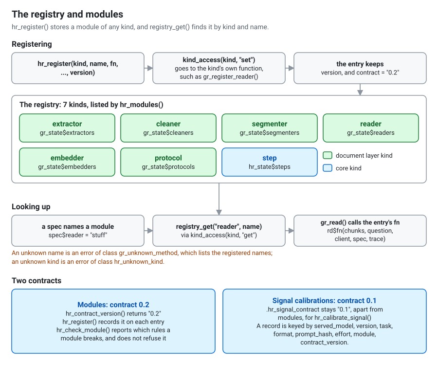

```{r setup, include = FALSE}
knitr::opts_chunk$set(collapse = TRUE, comment = "#>")
```

Each axis of harnessr is a registry: extractors and cleaners for ingest,
segmenters, readers, embedders, and models. You can list each registry, swap
one entry for another, and add your own.

harnessr treats your addition exactly as it treats a built-in. Your module
gets the same token caps, provenance and reporting, and it runs under the same
call and spending limits. You can name it in a recipe, put it in an
`ensemble`, and compare it against a built-in with `gr_compare()`.

This guide covers four tasks:

- registering each kind of module;
- declaring the calls and the cost of a module that calls the model;
- stating the parameters of a spec;
- checking your module against the contract the built-ins follow.

`vignette("harnessr")` introduces the package and its ideas.

## Setting up

The examples run offline. `hr_mock_client()` returns a client whose handler
is an ordinary R function. You can pass it anywhere a real client goes, and it
records every prompt it receives. Use it to check that your module does what
you expect before you pay for real calls. `embedder = "lexical"` keeps
embedding free and offline too.

```{r message = FALSE}
library(harnessr)
old <- hr_options(verbose = FALSE, embedder = "lexical")
cl <- hr_mock_client(function(messages, params) "Revenue was 45.2 million dollars.")
```

## Getting text in: extractors and cleaners

An extractor turns a file into text blocks. It is a function of `(path, opts)`
that returns a data frame with a `text` column, and optionally `page`,
`section` and `kind`. When you register it with `gr_register_extractor()`, you
name the file extensions it claims.

```{r}
gr_register_extractor("tsv", "tsv", description = "TSV, one block per row",
  fn = function(path, opts) {
    d <- utils::read.delim(path, stringsAsFactors = FALSE)
    data.frame(text = apply(d, 1, paste, collapse = " | "), kind = "table")
  })

tsv <- tempfile(fileext = ".tsv")
writeLines(c("region\trevenue", "north\t45.2", "south\t51.8"), tsv)
cat(gr_ingest(tsv)$text)
```

If your extractor cannot turn some pages into text, list them in
`attr(result, "gr_unread_pages")`. harnessr then marks an answer drawn from the
document as partial, as it does for a PDF page that needed OCR and did not get
it.

A cleaner is a function of `(text, opts)` that returns cleaned text. Its
`stage` sets when it runs:

- `"early"` steps preserve structure, as boilerplate removal does.
- `"late"` steps normalise destructively, as digit stripping does.

Early steps always run before late ones, whatever order you list them in.

```{r}
gr_register_cleaner("drop_confidential", stage = "early",
  description = "Remove CONFIDENTIAL banner lines",
  fn = function(x, o) gsub("(?mi)^\\s*CONFIDENTIAL.*$", "", x, perl = TRUE))

cleaned <- gr_clean("CONFIDENTIAL - DRAFT\n\nThe real content of the document.",
                    steps = c("drop_confidential", "collapse_whitespace"))
as.character(cleaned)
```

By default a cleaner runs on each text block. A cleaner that looks at position
or repetition across the whole document, such as one that drops a trailing
bibliography or a running head, needs `scope = "document"`. Run per block, it
would never fire. `?gr_register_cleaner` explains how harnessr matches its
result back to the blocks. `vignette("ingest")` covers the built-in extractors
and cleaners.

## Cutting text up: segmenters

A segmenter is a function of `(doc, spec, client, trace)` that returns a
`gr_chunks`. Build that object with `new_chunks()`, because `gr_segment()`
rejects anything else. The constructor gives your segmenter the same
invariants as the built-ins:

- it drops blank units;
- it assigns `chunk_id` in order;
- it measures tokens and characters;
- it recycles provenance to match.

```{r}
gr_register_segmenter("by_bullet", description = "one chunk per bullet",
  fn = function(doc, spec, client, trace) {
    units <- unlist(strsplit(doc$text, "\n(?=[-*])", perl = TRUE))
    new_chunks(units, "by_bullet", spec)
  })

subset(gr_segmenters(), name == "by_bullet")
```

`new_chunks()` does not enforce the token cap. `gr_segment()` checks the cap
after your function returns and splits anything oversized, so the chunks fit
even when your segmenter ignores `spec$max_tokens`. The conformance check later
in this guide reports each chunk that `gr_segment()` had to split.

Three arguments of `gr_register_segmenter()` describe what the segmenter
spends:

- `cost` is `"free"`, `"embedding"` or `"llm"`, so a UI can warn before
  anything is spent.
- `needs_client = TRUE` marks a segmenter that cannot work without a client.
  When there is no client, `gr_segment()` warns with class
  `gr_segment_fallback`. Your segmenter should then record what it fell back
  to in its `method` (`"mine->paragraph"`), so the downgrade shows in
  `gr_chunk_stats()`.
- `calls` declares the labels of its model calls, as the next sections
  describe for readers. `character(0)` declares that it makes none.

`vignette("segment")` covers the built-in segmenters.

## Reading: readers

A reader is a function of `(chunks, question, client, spec, trace)` that
returns a `gr_answer`, built with `new_answer()`. This one answers from the
longest chunk only:

```{r}
gr_register_reader("longest", signature = "one|1|none", cost_calls = "1",
  description = "answer from the longest chunk only",
  calls = "longest.answer",
  cost = function(input_stats, params) hr_cost(calls = 1),
  fn = function(chunks, question, client, spec, trace) {
    d <- chunks$chunks
    i <- which.max(d$tokens)
    res <- hr_call(client, list(list(role = "user",
             content = paste0(d$text[i], "\n\nQuestion: ", question))),
           model = spec$model, effort = spec$effort, trace = trace,
           label = "longest.answer")
    new_answer(res$text, "longest", question, d$chunk_id[i], trace,
               partial = !isTRUE(res$ok))
  })

ch <- gr_segment(gr_example(), list(method = "sentence", max_tokens = 120))
gr_read(ch, "What was revenue?", cl, "longest")$answer
```

Inside the function, `chunks$chunks` is the data frame of chunks (`chunk_id`,
`text`, `tokens`, `chars`, `page`, `section`, `block_id`). When you write the
function:

- Send every request through `hr_call()` with the client you were given,
  never one you construct, and pass it the `trace`. Through the trace,
  `hr_call()` counts, prices and limits your calls.
- Expect refusals. harnessr does not send a request that would pass
  `max_calls` or `max_cost_usd`, and `hr_call()` returns a result with
  `refused = TRUE` instead. Stop or degrade when that happens.
- Honour at least `spec$model`, `spec$max_answer_tokens`, `spec$temperature`
  and `spec$effort`.
- Budget the prompt with `hr_budget()` instead of assuming the document fits.

The `signature`, `"select|calls|state"`, describes how the reader traverses
the chunks. Two readers with the same signature are the same method under two
names. `gr_compare()` uses the signature to decide whether two recipes are the
same experiment, and `ensemble` refuses members that share one.

A `select` of `"all"` declares that the reader sends every chunk. harnessr then
refuses a run whose chunks alone would cost more than `max_cost_usd` before its
first request. `gr_reader_signature()` reports a reader's signature, so you can
check whether two readers that claim to differ do differ. `cost_calls` is a
description for people, shown by `gr_readers()`; the pre-flight check never
reads it.

The name `"auto"` is reserved, because `answer_document()` uses it to choose a
recipe. `vignette("readers")` covers the built-in readers.

## Declaring calls

Every `hr_call()` carries a `label`, and the trace records it in its `stage`
column. A module declares the stems of its labels in `calls`. A stem covers a
label that equals it or that starts with it followed by a dot. If you leave
`calls` out, the module declares its own name, which covers labels such as
`"longest.answer"` for a reader called `"longest"`.

`gr_read_spec()` checks an `effort` map against these declarations. Each name
in `gr_read_spec(effort =)` must be a declared stem, a part of one up to a dot,
or a label under one. Any other name raises an error of class
`hr_unknown_effort_key` that lists the stems. Without the check, that setting
would silently reach no request:

```{r}
spec <- gr_read_spec("longest", effort = c(longest = "low"))
spec$effort

tryCatch(gr_read_spec("longest", effort = c(longst = "low")),
         hr_unknown_effort_key = function(e) "refused: no call is labelled 'longst'")
```

To name the calls of your own module in an effort map, register the module
first, with its labels in `calls`. The `calls` column of `gr_readers()` and
`gr_segmenters()` lists every module's stems. `vignette("runs")` explains what
effort does and which models it is sent to.

## Declaring cost

The `cost` argument of `gr_register_reader()` is a function of
`(input_stats, params)` that returns `hr_cost()`: how many requests one run
makes, expected and at worst. `params` is the `gr_read_spec()`. `input_stats`
holds:

- `n_chunks`, `tokens` (of all chunks), `texts` and `question`;
- `out_cap`, the largest reply cap a request to `params$model` is sent;
- `embed_api`, whether embeddings go to the endpoint at all;
- the helpers `reply_cap(model, cap)`, `room(system, restate)` and
  `embed_requests(texts)`.

This reader asks every chunk and then merges the notes, so it makes one request
per chunk plus one:

```{r}
gr_register_reader("each", signature = "all|N+1|none", cost_calls = "N + 1",
  description = "ask every chunk, then merge",
  calls = c("each.chunk", "each.merge"),
  cost = function(input_stats, params) hr_cost(calls = input_stats$n_chunks + 1),
  fn = function(chunks, question, client, spec, trace) {
    d <- chunks$chunks
    notes <- vapply(seq_len(nrow(d)), function(i) {
      hr_call(client, list(list(role = "user",
                content = paste0(d$text[i], "\n\nQuestion: ", question))),
              model = spec$model, effort = spec$effort, trace = trace,
              label = "each.chunk")$text
    }, character(1))
    res <- hr_call(client, list(list(role = "user",
             content = paste(c(notes, question), collapse = "\n\n"))),
           model = spec$model, effort = spec$effort, trace = trace,
           label = "each.merge")
    new_answer(res$text, "each", question, d$chunk_id, trace,
               partial = !isTRUE(res$ok))
  })

a <- gr_read(ch, "What was revenue?", cl, "each")
table(as.data.frame(a$trace)$stage)
```

Before the first request, `gr_read()` adds up the cost functions of a run, and
the governor checks the sum against its limits. Under a cap of three calls, the
governor refuses the six chunks above before anything is sent:

```{r}
capped <- hr_options(max_calls = 3)
tryCatch(gr_read(ch, "What was revenue?", cl, "each"),
         gr_call_cap = function(e) conditionMessage(e))
hr_options(capped)
```

For a reader registered without `cost`, the pre-flight check counts one
request per chunk and, for a signature whose `select` is `"all"`, every chunk sent once.
Declare `cost` for any reader that makes a different number of requests.

`hr_cost()` has more fields than `calls`:

- `calls_max` is the worst case, never taken as less than `calls`.
- `tokens_in_max` counts prompt tokens sent beyond the input itself, such as
  replies handed on to a merge.
- `tokens_out_max` is for a reader whose replies can be billed beyond the
  reply cap. Without it, the check prices every request at
  `input_stats$out_cap`.
- `embed_max` counts requests to the embeddings endpoint.
- `sends` lists input every run must send, as `list(tokens =, model =)`, so
  the pre-flight check refuses a run that cannot finish under the spending
  limit before it starts.

```{r}
hr_cost(calls = 4, calls_max = 6)$calls_max
```

`vignette("runs")` covers the governor, its limits and the pre-flight step in
the trace.

## Embedders

Embedders are a registry too. With a local embedder, `retrieve` and the
`semantic` segmenter work offline, for free, and reproducibly:

```{r}
gr_embedders()
```

`hr_options(embedder = "lexical")` switches every part of the package that
embeds.

An embedder is a function of `(texts, params)` that returns a numeric matrix
with one row per text. L2-normalise each row, because harnessr treats the
cross-product as cosine similarity everywhere downstream. `params` carries
`client`, `model`, `batch_size`, `cache` and `trace`. To signal failure, raise
an error; the caller applies its own fallback.

Register your own embedder (a local model, a company service) and select it
with `hr_options(embedder =)`. The `semantic` segmenter and the `retrieve` and
`iterative` readers then all use it, with no change to any of them.

```{r}
gr_register_embedder("first-letters", description = "Toy: letter counts",
  deterministic = TRUE,
  fn = function(texts, params) {
    t(vapply(texts, function(tx) {
      v <- numeric(26)
      ltr <- utf8ToInt(tolower(substr(tx, 1, 40))) - 96L
      for (i in ltr[ltr >= 1 & ltr <= 26]) v[i] <- v[i] + 1
      n <- sqrt(sum(v^2)); if (n == 0) v else v / n
    }, numeric(26), USE.NAMES = FALSE))
  })

toy <- hr_options(embedder = "first-letters")
attr(hr_embed(cl, c("alpha", "beta")), "embedding_source")
hr_options(toy)
```

Set `deterministic = TRUE` only if the same text always gives the same vector,
in any session on any machine. A trace records model calls but not vectors.
The flag lets `hr_replay_client()` recompute a run's chunk ranking instead of
degrading to lexical vectors. If you set it wrongly, a replay ranks chunks from
vectors the original run never saw and still reports an exact match.

## Models

The model registry holds each model's context window, output limit and prices.
harnessr ships the limits of its built-in models and no prices. Use
`hr_register_model()` to add a model the package does not know, to correct a
built-in entry, or to give a model the prices you pay:

```{r}
hr_register_model("my-local-llama", context_window = 32768, max_output = 4096)
hr_model_info("my-local-llama")[c("context_window", "source", "certain")]
```

Without prices, harnessr cannot estimate a cost. It returns `NA` instead of
assuming the run is free:

```{r}
is.na(hr_estimate_cost("my-local-llama", 1000, 500))
```

While a spending limit is set, harnessr sends a request to a language model
with no registered price and warns, once per model per session, that the limit
does not count it. Embedding models and `hr_mock_client()` are exempt. Give
`input_usd` and `output_usd` in US dollars per million tokens, zero for a local
model, and the limit counts the model's requests. To refuse unpriced requests
instead, set `hr_options(allow_unpriced = FALSE)`.

The section on connecting to a model in `vignette("harnessr")` registers a
hosted model at its prices and a local one at zero, both reached through
ellmer. `reasoning = TRUE` marks a model that takes an
effort setting. To set the prices of many models at once from a file, and to
keep them current, see "Models, prices and token counts" in
`vignette("runs")`.

## Using what you registered

You name a registered module as you name a built-in. A recipe binds one
choice from each axis, and `answer_document()` runs it:

```{r}
mine <- gr_recipe("bullets_longest",
                  segment = list(method = "by_bullet", max_tokens = 400),
                  read = list(reader = "longest"))
answer_document(gr_example(), "What was revenue?", recipe = mine,
                client = cl)$answer
```

`gr_compare()` runs several recipes on one document and question, sharing one
trace, so you can measure your addition against a built-in on calls, tokens
and cost:

```{r}
cmp <- gr_compare(gr_example(), "What was revenue?",
                  recipes = list(mine, "fast"), client = cl)
cmp$summary[, c("recipe", "segmenter", "chunks", "reader", "calls")]
```

## Registering any kind with hr_register()

`hr_register()` registers a module of any kind. Name the kind first. The
other arguments are those of that kind's own function, so
`hr_register("reader", ...)` takes what `gr_register_reader()` takes and runs
the same checks. This reader answers from the shortest chunk:

```{r}
shortest <- function(chunks, question, client, spec, trace) {
  d <- chunks$chunks
  i <- which.min(d$tokens)
  res <- hr_call(client, list(
    list(role = "user", content = paste0(d$text[i], "\n\nQuestion: ", question))),
    model = spec$model, effort = spec$effort, trace = trace,
    label = "shortest.answer")
  new_answer(res$text, "shortest", question, d$chunk_id[i], trace)
}
hr_register("reader", "shortest", signature = "one|1|none", cost_calls = "1",
  description = "answer from the shortest chunk only", calls = "shortest.answer",
  fn = shortest)
```

The kinds are `"extractor"`, `"cleaner"`, `"segmenter"`, `"reader"`,
`"embedder"`, `"protocol"` and `"step"`. For any other kind, `hr_register()`
raises an error of class `hr_unknown_kind`. It also refuses a module that the
kind's own function would refuse:

```{r}
tryCatch(hr_register("reader", "auto", fn = identity, signature = "one|1|none"),
         gr_reserved_name = function(e) conditionMessage(e))
```

The registry holds the modules of every kind. `hr_register()` stores an entry
with its version and contract, and a lookup such as `gr_read()` finds the entry
by name and calls its function:

```{r registry, echo = FALSE, out.width = "100%", fig.alt = "hr_register(kind, name, fn, ..., version) stores an entry in the registry under one of seven kinds: extractor, cleaner, segmenter, reader, embedder, protocol and step. hr_register() stamps each entry it stores with its version and module contract 0.2. A lookup such as gr_read() calls registry_get() with the kind and name and calls the entry's fn; an unknown name raises gr_unknown_method and an unknown kind hr_unknown_kind. Signal calibrations keep their own contract, 0.1."}

```

`hr_modules()` lists the modules of every kind in one table, with the call
stems each declares as a list column. Give it a kind to add that kind's own
columns:

```{r}
m <- hr_modules()
table(m$kind)
r <- hr_modules("reader")
r[r$name %in% c("longest", "shortest"), c("name", "signature", "calls")]
```

Listings such as `gr_readers()` keep their own columns. A module you register
with `hr_register()` appears in them as one registered with the kind's own
function does. Each listing ends with two more columns:

- `version`, the version you gave `hr_register()`;
- `contract`, the module contract it was registered under.

A module registered with a `gr_register_*()` function has `NA` in both. Pass
`version` when you register, and the listings show which version of your
module is in place:

```{r}
hr_register("reader", "shortest", signature = "one|1|none", cost_calls = "1",
  description = "answer from the shortest chunk only", calls = "shortest.answer",
  version = "1.1.0", fn = shortest)
r <- gr_readers()
r[r$name %in% c("longest", "shortest"), c("name", "version", "contract")]
```

A step from `hr_step()` registers the same way, under the kind `"step"`. Its
version is the step's own unless you give another:

```{r}
hr_register("step", "shout", fn = hr_step("shout", function(input, ctx) toupper(input),
                                          input = "answer", output = "state",
                                          version = "0.2.0"))
hr_modules("step")[, c("name", "input", "output", "version", "contract")]
```

Through `hr_register()`, a segmenter that calls a model can also take
`effort_label`. It is a function of the segment spec that returns the label
the segmenter's requests carry, or `""` when the spec sends none. With it,
your segmenter receives only the effort for that label from a run's `effort`
map, as the built-in `contextual` and `proposition` segmenters do. Without
`effort_label`, your segmenter gets the whole map and picks its own labels
from it.

## Parameter schemas

Each spec constructor states its parameters once, as a schema: type, default,
range and choices. `gr_read_spec()`, `gr_segment_spec()` and `gr_ingest_spec()`
check their arguments against a schema. You can use the same three schema
functions for a module of your own:

- `hr_param()` declares one parameter;
- `hr_schema()` collects them;
- `hr_validate()` applies the rules.

```{r}
s <- hr_schema(
  hr_param("max_tokens", "integer", default = 1200L, min = 32, max = 1e6,
           help = "Largest chunk, in tokens."),
  hr_param("overlap_tokens", "integer", default = 0L, min = 0,
           max = function(p) p$max_tokens - 1L,
           help = "Tokens repeated between neighbouring chunks."),
  hr_param("order", "enum", choices = c("relevance", "document"),
           help = "How chosen chunks are ordered in the prompt."))
s
```

`hr_validate()` resolves the parameters in schema order, so a parameter whose
bound depends on another, such as `overlap_tokens` above, comes after it. It
moves a number out of range to the nearest bound and warns with class
`gr_clamped` (and `hr_param_clamped`). It matches an `enum` as `match.arg()`
does, so it accepts an unambiguous abbreviation:

```{r}
withCallingHandlers(
  str(hr_validate(s, list(max_tokens = 100, overlap_tokens = 500, order = "doc"))),
  gr_clamped = function(w) {
    message(conditionMessage(w))
    invokeRestart("muffleWarning")
  })
```

A name the schema does not have raises an error of class `hr_unknown_param`.
A value outside an `enum`'s choices raises an error that names the choices:

```{r}
tryCatch(hr_validate(s, list(top_k = 3)),
         hr_unknown_param = function(e) conditionMessage(e))
```

The types are `integer`, `number`, `string`, `boolean`, `enum`,
`string_vector`, `named_map`, `module_ref` and `file`; `?hr_param` gives the
rule for each. For a parameter that needs a rule of its own, a `resolve`
function replaces the type's rule.

The other fields describe the parameter and do not check it:

- `help`: one plain sentence.
- `cost_class`: how it moves the cost of a run, one of `"none"`, `"local"`,
  `"per_call_constant"`, `"per_unit"`, `"per_sample"` or `"per_round"`.
- `affects_output`: whether it belongs in cache and store keys.
- `tier`: `"basic"` or `"advanced"`, for grouping in a user interface.
- `evidence`, `depends_on` and `since`.

These fields let a later UI or command line be built from the same list.

## Checking a module against the contract

`gr_check_reader()` and `gr_check_segmenter()` run one registered module on the
bundled example document, through an offline client, and report which rules of
its contract it breaks. In this release the checks only report. Registering
a module does not run them, and a module that breaks a rule stays registered
and runs as before. Every built-in reader and segmenter passes.

The `longest` reader above passes all nine reader rules:

```{r}
gr_check_reader("longest")
```

This one does not. It sends a call under a label it did not declare, makes two
requests where its cost function promised one, and names a chunk that does not
exist:

```{r}
gr_register_reader("loose", signature = "one|2|none", calls = "loose.answer",
  cost = function(input_stats, params) hr_cost(calls = 1),
  fn = function(chunks, question, client, spec, trace) {
    hr_call(client, list(list(role = "user", content = question)),
            model = spec$model, trace = trace, label = "other.answer")
    res <- hr_call(client, list(list(role = "user", content = question)),
                   model = spec$model, trace = trace, label = "loose.answer")
    new_answer(res$text, "loose", question, 99L, trace)
  })

gr_check_reader("loose")
```

The broken rules print first, each with what the check found. The nine reader
rules are:

- `is_function`;
- `runs`: it finishes without an error;
- `answer_class` and `answer_fields`: a `gr_answer` with every documented
  field;
- `answer_text`: a single string;
- `evidence` and `chunks_used`: they name only chunks of the input;
- `calls_declared`: every label is under a declared stem;
- `calls_within_cost`: no more requests than the cost function's worst case,
  or `NA` for a reader registered without `cost`.

The `by_bullet` segmenter from earlier fails one rule. The example document has
no bullets, so `by_bullet` returns it as a single chunk over the 150-token cap
the check cuts with, and `gr_segment()` has to split it:

```{r}
gr_check_segmenter("by_bullet")
```

Splitting on blank lines as well as bullets keeps every chunk under the cap:

```{r}
gr_register_segmenter("by_bullet", description = "one chunk per bullet or paragraph",
  fn = function(doc, spec, client, trace) {
    units <- unlist(strsplit(doc$text, "\n(?=[-*])|\n\\s*\n", perl = TRUE))
    new_chunks(trimws(units), "by_bullet", spec)
  })

gr_check_segmenter("by_bullet")
```

The segmenter rules are `is_function`, `runs`, `chunks_class`,
`chunk_columns` (the documented columns), `chunk_text` (no blank chunk),
`chunk_ids` (unique, not `NA`), `within_cap` and `calls_declared`. The check
gives the offline client to a segmenter that needs a client or declares calls.
Pass `client =` to check it against another client.

Both checks return an `hr_conformance` data frame with `rule`, `ok` and
`detail` columns. If you maintain a package of modules, its tests can assert on
that data frame:

```{r}
res <- gr_check_reader("loose")
res$rule[!is.na(res$ok) & !res$ok]
```

To check a module against a provider that misbehaves, give the check a mock
client with a `mode`:

- `"bad_json"` sends JSON cut off part way.
- `"refuse"` sends empty replies.
- `"at_cap"` marks every reply as cut off at the output cap.
- A vector of HTTP status codes gives call `i` the `i`-th status, so
  `c(429, 500, 200)` fails the first two calls and answers every one after.

The `longest` reader still finishes, and stays within its cost, when every
request is rate limited:

```{r}
gr_check_reader("longest", client = hr_mock_client(mode = 429))
```

`hr_check_module()` is the core helper both checks use, and it works for a
module of any kind. Give it three things:

- the module's function;
- a closure of no arguments that runs the module once;
- a named list of rules, each a function of the value the closure returned.

A rule returns `TRUE`, `FALSE`, `NA` (could not be checked), or a list with
`ok` and a `detail` string. The closure runs in a temporary working directory
that `hr_check_module()` removes afterwards, and the `runs` rule reports any
error the closure raises.

```{r}
double_it <- function(x) x * 2
hr_check_module(double_it, function() double_it(2),
  rules = list(numeric = function(v) is.numeric(v),
               above_three = function(v) list(ok = v > 3, detail = sprintf("got %s", v))),
  kind = "function", name = "double_it")
```

```{r include = FALSE}
hr_options(old)
```

## Next

- `?gr_register_reader` and `?gr_register_segmenter`: the full contract for
  each, with every argument a module receives.
- `?new_chunks` and `?new_answer`: the constructors a segmenter and a reader
  return.
- `vignette("runs")`: limits, the pre-flight check, effort, and replaying a run.
