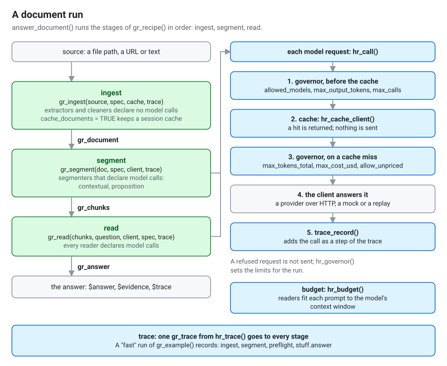

```{r setup, include = FALSE}
knitr::opts_chunk$set(collapse = TRUE, comment = "#>")
```

harnessr asks a large language model questions about your documents (a report, a
contract, a folder of research papers) and returns the answer with a record of
how it was reached: which parts of the document the model saw, what it was
asked, what it said, and what that cost. You need no previous experience with
language models. This guide covers the few ideas you need, then installing the
package, then a first question from start to finish.

Everything below runs without an account or an internet connection, so you can
follow along for free.

## A few ideas first

**The model runs somewhere else.** A large language model (an *LLM*) such as
GPT is a program run by a *provider*: OpenAI, Google, or a model on your own
computer. harnessr sends it text over the internet and reads the reply.
Commercial providers charge for each request.

**Text is measured in tokens.** Models read text as *tokens*, which are pieces
of words. In English a token is roughly four characters,
so a page of text is several hundred tokens. Providers charge per token, both
for the text you send and, at a higher rate, for the text the model writes back.

```{r message = FALSE}
library(harnessr)
```

```{r}
hr_count_tokens("Revenue rose to 45.2 million dollars in fiscal 2024.")
```

harnessr estimates token counts itself, without asking the provider, so it can
work out what a request will cost before sending it.

**A model can only take in so much at once.** The most text a model accepts in a
single request is its *context window*. A long report may not fit, and even when
it does, models tend to overlook details in the middle of a very long prompt.
harnessr therefore cuts documents into smaller pieces, called *chunks*, and puts
the question to the chunks in some order.

**That makes three decisions**, and harnessr keeps them separate so you can see and
change each one:

1. **Ingest**: get the text out of the file and tidy it.
2. **Segment**: cut the text into chunks.
3. **Read**: decide how the model works through the chunks. It can take all of
   them in one request, each one separately, or only the most relevant few,
   among other strategies.

A fourth choice, which model answers, is independent of all three.
`vignette("ingest")`, `vignette("segment")` and `vignette("readers")` cover the
three steps in depth.

Each step is a registry you can extend without editing the package
(`vignette("extending")`). The built-in entries:

- Ingest has 6 extractors and 14 individually toggleable cleaners.
- Segment has 9 segmenters.
- Read has 12 strategies, each with a distinct traversal signature.

Any ingest composes with any segmenter and any reader. `gr_recipe()` binds one
of each into a named pipeline. Run a recipe alongside others in `gr_compare()`
and it gives the same `$answer` and `$chunks_used`, byte for byte, as when you
run it alone.

**Models can make things up.** A model may state something the document never
says, and it can do so fluently. harnessr cannot prevent that. It records which
text each answer rests on, checks quotations against the document, and tells you
when anything went wrong. The first example below shows where to look.

## Installing

harnessr needs R 4.1 or later. Install it from GitHub:

```{r eval = FALSE}
install.packages(c("remotes", "knitr", "rmarkdown"))
remotes::install_github("elkronos/harnessr", build_vignettes = TRUE)
```

The package and its repository were called readgpt up to version 0.6.0.
Caches and recordings made under that name still answer. The v1 functions and
the `readgpt.*` options are removed; `NEWS.md` lists each one with its
replacement.

`build_vignettes = TRUE` also installs these guides, so `vignette()` can open
them. Building them needs `knitr`, `rmarkdown` and Pandoc. Pandoc comes with
RStudio; without RStudio, install it from <https://pandoc.org/installing.html>
first, or leave out `build_vignettes = TRUE`.

The package itself depends only on `digest`, `httr` and `jsonlite`. Some file
types and features need an extra package. Each is optional, so install only what
you use:

| to do this | install |
|---|---|
| read PDFs | `pdftools` |
| read Word documents and web pages | `xml2` (or `readtext`, for Word only) |
| read scanned pages and images (OCR) | `tesseract` and `magick` |
| use a provider other than OpenAI | `ellmer` |
| run many requests at once | `future` and `future.apply` |
| count tokens with OpenAI's own tokenizer | `reticulate`, with Python's `tiktoken` |
| use the point-and-click app | `shiny` |

If you ask for something that needs a package you do not have, harnessr says
which one. It stops, unless it can carry on without it. For example, it runs
requests one at a time when the parallel packages are missing.

## Connecting to a model

To use a real model you need an account with a provider and an *API key*, a
password that identifies your account to the provider's servers. For OpenAI,
create one at <https://platform.openai.com>.

Keep the key out of your scripts. The usual place is your `.Renviron` file, which
R reads when it starts:

```{r eval = FALSE}
file.edit("~/.Renviron")
# add this line, save the file, then restart R:
# OPENAI_API_KEY=sk-...
```

`hr_api_key()` checks that R can see it, and stops with an explanation if it
cannot:

```{r eval = FALSE}
hr_api_key()
```

There are three places to give the key. An argument to `hr_client()` wins over
the `harnessr.api_key` option, which wins over `OPENAI_API_KEY`:

```{r eval = FALSE}
Sys.setenv(OPENAI_API_KEY = "sk-...")    # for the session
options(harnessr.api_key = "sk-...")     # the form for an .Rprofile
cl <- hr_client(api_key = "sk-...")      # per client, for a Shiny app with many users
```

If your project is a git repository, list `.Renviron` and `.Rprofile` in its
`.gitignore`; harnessr's own repository ignores both.

If the key is missing, `answer_document()`, `gr_read_many()` and `gr_compare()`
stop before they read your document, with a `gr_auth_error` that gives the same
explanation. So a missing key does not first cost an OCR pass over a long scan.

Behind a company gateway, `hr_client(headers = )` sends the headers it wants,
such as Azure's `api-key`:

```{r eval = FALSE}
cl <- hr_client(
  base_url = "https://gateway.example.com/openai/v1", api = "chat",
  headers  = c("api-key" = Sys.getenv("GATEWAY_KEY"), Authorization = NA))
```

Naming a header replaces the automatic `Authorization`, and `NA` suppresses one,
which keeps a personal `OPENAI_API_KEY` off the gateway. Naming any header makes
the key optional, so a client that authenticates through headers needs no key.
`hr_options(api_headers = )` sets the same headers for every client, the form
for a project's `.Rprofile`.

The built-in client speaks to OpenAI-compatible `/responses` and
`/chat/completions` endpoints. For other providers, `hr_ellmer_client()` hands
the transport to the [ellmer](https://ellmer.tidyverse.org/) package, which
covers about twenty providers, local models through Ollama among them.

The spending limit is on by default, and it can hold only for a model with a
registered price. So register the model the ellmer object was built with, at
your provider's current prices in US dollars per million tokens. A local model
has no price to register, so let it run unpriced:

```{r eval = FALSE}
library(ellmer)

hr_register_model("claude-sonnet-4-5", context_window = 200000, max_output = 64000,
                  input_usd = 3, output_usd = 15)
cl <- hr_ellmer_client(chat_anthropic(model = "claude-sonnet-4-5"))
answer_document("report.pdf", "What was revenue?", "thorough", client = cl)

hr_options(allow_unpriced = TRUE)
cl <- hr_ellmer_client(chat_ollama(model = "llama3.1"))
```

Without a registered price, a run under `max_cost_usd` stops before its first
request with an `hr_unpriced_model` error. `vignette("runs")` covers unpriced
models and what changes through ellmer (temperature and embeddings).

Anything else, such as a model behind a queue, goes through
`hr_backend_client()`. It makes any function of `messages` and `params` that
returns a string the transport. Limits, the trace, caching and replay work the
same way on every client. Register the model's real context window with
`hr_register_model()`, since it sizes your chunks.

## Practising without a key

For learning, a real model is unnecessary. `hr_mock_client()` builds a stand-in
that replies with whatever an R function returns, and it can be used anywhere a
real model can. This one always gives the same answer, which is enough to see
how everything else works:

```{r}
cl <- hr_mock_client(function(messages, params) "Revenue was 45.2 million dollars.")
old <- hr_options(verbose = FALSE)
```

`verbose = FALSE` stops harnessr printing a line for each stage; leave it on in
your own work while you are learning. In an interactive session it also keeps a
line up to date with how far a long read has got and what it has spent.
`hr_options()` returns the settings it replaced, so they can be restored later
with `hr_options(old)`.

## Your first question

`answer_document()` does all three steps in one call. harnessr includes a short
example document, an annual report:

```{r}
ans <- answer_document(gr_example(), "What was revenue in 2024?", client = cl)
ans$answer
```

That call ran three stages in order. `gr_ingest()` handed a `gr_document` to
`gr_segment()`, which handed a `gr_chunks` to `gr_read()`. Each request to the
model goes through `hr_call()`, where the governor checks the limits and, for a
client wrapped in `hr_cache_client()`, the cache answers a repeat. One trace
records every step:

```{r document-run, echo = FALSE, out.width = "100%", fig.alt = "answer_document() runs three stages in order: ingest with gr_ingest() hands a gr_document to segment with gr_segment(), which hands a gr_chunks to read with gr_read(), which returns a gr_answer. Each model request goes through hr_call(), where the governor checks the limits, the cache of a client wrapped in hr_cache_client() answers a repeat and the client answers a miss. One trace from hr_trace() goes to every stage, and readers size prompts with hr_budget()."}

```

With a real model you would leave out `client =` and point it at your own file:

```{r eval = FALSE}
ans <- answer_document("annual-report.pdf", "What was revenue in 2024?")
```

The first argument can be a path to a file, a web address, or the text itself.
A missing file whose name ends in an extension harnessr reads (`.pdf`, `.docx`,
`.md` and so on) is an error. Any other string is read as the text of the
document, including a path with a mistyped extension:
`"reports/2024/annual-report.pfd"` becomes a one-line document about a file name.
`ans$document$source` shows which happened: the path for a file, the address for
a download, `<inline text>` for a string.

## Checking the answer

`ans` holds much more than the answer. Look at three things before relying on
it.

**`partial` says whether anything went wrong.** It is `TRUE` if a request
failed, if chunks were left out because they did not fit, if a limit on
requests or spending stopped the run early, if a reading strategy fell back to
a simpler method, or if pages of the document never became text (a scanned
page read without OCR, for example):

```{r}
ans$partial
```

When it is `TRUE`, printing the answer says why, and `ans$notes` holds the
details. Here is a "model" that fails every request, as a network outage would:

```{r}
broken <- hr_mock_client(function(messages, params) stop("no connection"))
bad <- answer_document(gr_example(), "What was revenue in 2024?",
                       client = broken)
bad
```

The run did not stop with an error. It finished, and the failure is recorded on
the result, so check `partial` every time. Any warnings raised along the way are
kept in `ans$warnings` as well as printed, so they can still be read after the
console has scrolled past them.

**`is_not_found()` says whether the document had the answer at all.** Every
reading strategy tells the model to reply with a fixed marker when the text it
was shown does not answer the question, so "the document does not say" can be
told apart from an answer:

```{r}
is_not_found(ans$answer)
is_not_found(bad$answer)
```

For `bad`, the marker means "no answer came back", and `partial` says that was a
failure rather than a finding.

A question can also assume something the document contradicts, such as "Why did
revenue fall?" of a report in which revenue rose. The model then either answers
as if the assumption were true or replies with the marker. Add `premise = TRUE`
to the call and the model is told that, when the document says the opposite, it
should say so in one sentence giving what the document states. That sentence is
the answer and `ans$premise`, and `is_not_found()` is `FALSE` for it. A document
that is merely silent still gets the marker. It is off by default, and the
correction is the model's reading, not a check harnessr makes (`?gr_read_spec`).

**`evidence` shows what the answer rests on.** Each row is a chunk the answer
drew on, with where it came from: the page, for a PDF, and the heading it sits
under. This short report fitted in a single chunk spanning several headings, so
there is one row and both are empty:

```{r}
ans$evidence[, c("chunk_id", "page", "section")]
```

On a long document there is a row for every chunk used, and `page` and `section`
tell you where to find the passage. What each row's `text` holds depends on the
reading strategy. When the model is asked to quote the document, harnessr checks
every quotation against the text and marks the answer `partial` if one is not
there. `vignette("readers")` shows both.

To see the passages in place, write the answer out as a page.
`gr_audit_report()` shows the answer, whether it is partial, the cost, and each
passage with its page and section, with the quotation or the answer's numbers
highlighted. In an interactive session it opens the page for you:

```{r, eval = FALSE}
gr_audit_report("answer.html", answer = ans)
```

## What it cost

Every result carries a *trace*: each request sent, each reply, and the tokens
both used.

```{r}
hr_trace_summary(ans$trace)[, c("calls", "tokens_in", "tokens_out")]
hr_trace_cost(ans$trace)[, c("model", "calls", "usd")]
```

`as.data.frame()` gives one row per request, with its cost and how long it took.
The `prompt` and `reply` columns hold exactly what was sent and what came back:

```{r}
as.data.frame(ans$trace)[, c("stage", "tokens_in", "tokens_out", "usd", "seconds")]
```

`usd` is priced from harnessr's list of known models (`hr_models()`). A model it
does not know is priced as unknown rather than free. You can also estimate
before sending anything. Here is a 120,000-token document with a 4,000-token
answer:

```{r}
hr_estimate_cost(hr_options("model"), input_tokens = 120000, output_tokens = 4000)
```

Two safety limits are on from the start: $5 and 400 requests per document. Each
request is checked before it is sent, against what the run has spent plus the
most that request could cost, and one that could pass a limit is not sent. A run
stopped that way is marked partial, and printing it says which limit stopped it.
A run that could not finish inside the limits is refused before the first
request: one that would need more than 400 requests, or one whose chunks would
cost more than $5 to send once:

```{r}
unlist(hr_options()[c("max_cost_usd", "max_calls")])
```

Change them with `hr_options()`, for example `hr_options(max_cost_usd = 20)`.
`vignette("runs")` covers the other limits, and how to cache a run so it is paid
for once.

The default models also *reason* before they answer: they work through the
question in text you never see, and it is charged as text the model writes back.
`effort` sets how much, for example `"low"` or `"high"`. Unless you set it,
nothing is sent and the provider's default applies. harnessr sends it only to a
model it knows reasons. The mock is not one, so here it is given the default
model's name to stand in for it:

```{r}
low <- answer_document(gr_example(), "What was revenue in 2024?",
                       client = cl, model = hr_options("model"), effort = "low")
as.data.frame(low$trace)[, c("stage", "model", "effort")]
```

With a real client on the default model, `effort = "low"` alone is enough. The
trace records the effort each request carried; the `effort` column appears only
when a request carried one. Less reasoning costs less. `effort` can also
differ by stage, low for the many routine requests and high for the few that
judge; `?gr_read_spec` lists the stages and suggests a starting point.

## Choosing a recipe

`answer_document()` made the three decisions using a *recipe*, a named
combination of choices. The default, `"auto"`, picks one of two by the
document's length: `"fast"`, which sends the whole document in one request, for
up to 50,000 tokens (less on a model with a small context window), and
`"thorough"`, one request per chunk, for anything longer. `ans$recipe` says
which it picked:

```{r}
ans$recipe
```

The built-in recipes:

```{r}
do.call(rbind, lapply(names(gr_recipes()), function(n) {
  r <- gr_recipes(n)
  data.frame(recipe = n, chunks = r$segment$method, reading = r$read$reader)
}))
```

A starting point for each kind of job:

| your document and question | try |
|---|---|
| short enough to send whole | `"fast"` |
| one fact somewhere in a long document | `"needle"` |
| every mention has to be found | `"thorough"` |
| long, with headings, and you want a summary | `"survey"` |
| scanned pages, forms or invoices | `"scanned"` |
| an argument that builds through the text | `"narrative"` |
| a question that needs several facts combined | `"research"` |
| high stakes, and you want a second opinion | `"consensus"` |

Pass the name as the third argument:

```{r}
fast <- answer_document(gr_example(), "What was revenue in 2024?", "fast",
                        client = cl)
fast$reader
```

Recipes differ a great deal in cost. `"thorough"` sends every chunk to the model
separately, so a long document means many requests; `"fast"` and `"needle"` make
one. `vignette("readers")` explains each reading strategy and when to use it,
and how to change a recipe's settings or build your own.

To choose a recipe or a model on more than one document, `hr_benchmark()` runs
each configuration several times over a labelled set of questions under one
spending limit. `hr_report()` gives accuracy, paired differences and cost, with
intervals that treat the questions about one document as a cluster. See
`vignette("evaluate")`.

## What you can change

A recipe is a set of settings, and every one of them can be changed. They are
grouped by the stage of a run they belong to:

```{r}
settings <- gr_settings_table()
table(factor(settings$stage, unique(settings$stage)))
```

| stage | settings | where you set it | guide |
|---|---|---|---|
| ingest | 21 | `gr_ingest_spec()`, or by name in `answer_document()` | `vignette("ingest")` |
| segment | 20 | `gr_segment_spec()`, or by name | `vignette("segment")` |
| read | 50 | `gr_read_spec()`, or by name; `gr_read_many()` for a folder | `vignette("readers")` |
| screen | 33 | the arguments of `gr_screen()` and the functions beside it | `vignette("review")` |
| extract | 10 | the arguments of `gr_extract()` | `vignette("review")` |
| synthesise | 29 | the arguments of `gr_synthesise()` and the functions beside it | `vignette("review")` |
| evaluate | 30 | the arguments of `hr_benchmark()`, `hr_report()` and `hr_judge()` | `vignette("evaluate")`, `vignette("compare")` |
| options | 34 | `hr_options()`, for the whole session | `vignette("runs")` |

Most runs change a few of them, which `gr_settings_table()` marks `basic`.
The ones that matter first, with their defaults and when to change each:

| stage | setting (default) | change it when |
|---|---|---|
| ingest | `clean` (`"standard"`) | the text carries captions, a reference list or running heads you do not want read (`"academic"`, `"scan"`), or a cleaner removed something you need |
| ingest | `ocr` (`"auto"`) | scanned pages that carry a printed header or stamp of 40 or more characters come back holding only that text (`"always"`), or pages of figures in a born-digital file are read by OCR for nothing (`"never"`) |
| ingest | `min_chars` (20) | short documents are refused that should be read, or near-empty extractions get through |
| segment | `method` (`"paragraph"`) | the document has headings to cut at (`"structural"`), pages that stand alone (`"page"`), or no paragraph breaks (`"sentence"`) |
| segment | `max_tokens` (1200) | a reader that sends every chunk makes too many requests (raise it), or one that picks a few sends too much text around the answer (lower it) |
| segment | `overlap_tokens` (0) | answers fall across the cut between two chunks |
| read | `reader` (`"map_reduce"`) | the question is one fact in a long document (`"retrieve"`), or needs exact quotations (`"skim"`); see "Choosing a recipe" above |
| read | `model` (the client's) | a cheaper model answers as well on your documents, or a stronger one is needed |
| read | `top_k` (6) | the chunk with the answer is not among those sent (raise it), or the prompt carries many unrelated chunks (lower it) |
| read | `cite` (`FALSE`) | you need to trace each statement to a chunk and a page |
| read | `verify` (`FALSE`) | you will act on quotations without reading the source |
| read | `recipe`, `store` and `max_total_usd` of `gr_read_many()` | a folder needs another recipe, a run long enough to be interrupted, or a cap on the whole run |
| screen | `screen_tokens` of `gr_screen()` (all that fits) | you screen on titles and abstracts, or the deciding sentence lies past the cap |
| screen | `recall_target` and `conf` (0.95 each), `n` and `of` of `gr_reference()` | your protocol promises a different recall, or the sample is too small to show it |
| extract | `resolve` (`"first"`) | chunks of one document disagree and the later value is the right one |
| extract | `require_quote` (`FALSE`) | the protocol says no quote, no datum |
| synthesise | `coherence` (`FALSE`) | the sections read as separate pieces, with terms that drift and studies introduced twice |
| synthesise | `cite_style` (`"auto"`) | the review needs numbered citations or plain markers |
| evaluate | `runs` (5) of `hr_benchmark()` | the report's notes ask for 10 |
| evaluate | `governor` of `hr_benchmark()` (the options' limits) | always, for a benchmark: size it for arms x items x runs x requests per run |
| options | `max_cost_usd` (5) and `max_calls` (400) | a run is stopped that should finish, or you want a mistake to stop sooner |
| options | `cache_dir` (a temporary directory) | a long run should be paid for once and survive the session |

`vignette("settings")` lists all 227 with their defaults and where each
default came from, and `gr_settings_table()` returns them in R. The settings
page links each important one to a walkthrough at the end of one of six
guides, which says what it trades off, the signs that point to changing it and
how to test a change. `hr_sweep()` builds one arm per value of a setting so the values can
be compared, as `vignette("compare")` shows.

## More than one document

For a folder of documents, `gr_read_many()` asks the same question of each file
and returns one row per document. For a literature review, `gr_screen()` decides
which documents meet your criteria, `gr_extract()` builds a table of the details
you ask for, and `gr_synthesise()` writes up the findings with each statement
citing the study it came from. `vignette("review")` covers each of these.

```{r include = FALSE}
hr_options(old)
```

## Where to go next

- `vignette("ingest")`: getting text out of PDFs, Word files, web pages and
  scans, and cleaning it.
- `vignette("segment")`: cutting documents into chunks, and comparing chunkings
  before you spend anything.
- `vignette("readers")`: the reading strategies and recipes, what each costs,
  and how to choose.
- `vignette("review")`: many documents and literature reviews, from a search
  export to a written review.
- `vignette("compose")`: building a run of your own from steps, and comparing
  it with the recipes.
- `vignette("runs")`: cost, limits, the trace, caching and replaying a run.
- `vignette("extending")`: adding your own extractors, cleaners, segmenters,
  readers and embedders.
- `vignette("settings")`: every setting of every stage, with its default and
  where the default came from.
- `?hr_options`: every option, with its default.

`browseVignettes("harnessr")` lists all the guides.

## Glossary

**API key**: a password identifying your account to a provider.

**Chunk**: a piece of a document small enough to send to the model.

**Context window**: the most text a model accepts in one request.

**Embedding**: a list of numbers standing for a piece of text, used to find
chunks similar to a question.

**Evidence**: the text an answer rests on, in `ans$evidence`.

**LLM**: large language model, the program that reads and writes text.

**Mock client**: a stand-in for a model that runs an R function, for practising
and testing without cost.

**Partial**: `ans$partial` is `TRUE` when a request failed, chunks did not fit
and were left out, the run stopped early, a reading strategy fell back to a
simpler method, or pages of the document never became text. Printing the answer
says which.

**Prompt**: the text sent to a model in one request.

**Provider**: the company or program that runs the model.

**Reader**: a strategy for working through the chunks.

**Recipe**: a named combination of an ingest, a segmentation and a reader.

**Segmenter**: a method of cutting text into chunks.

**Token**: the unit models read and providers charge by, roughly four characters
of English.

**Trace**: the record of every request and reply in a run.
